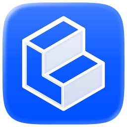
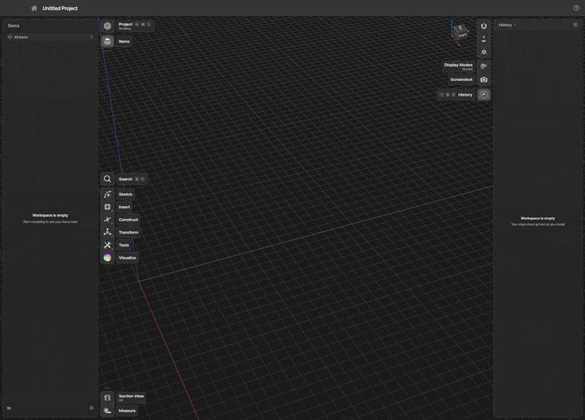
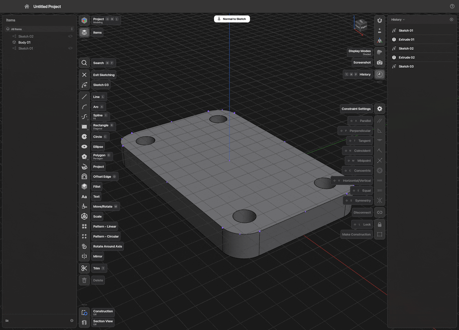
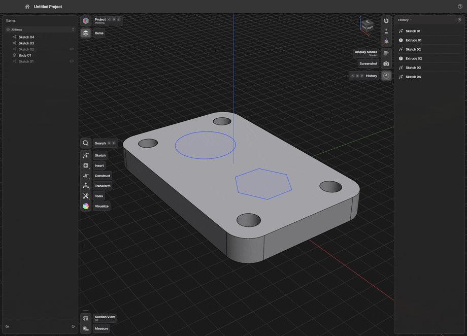
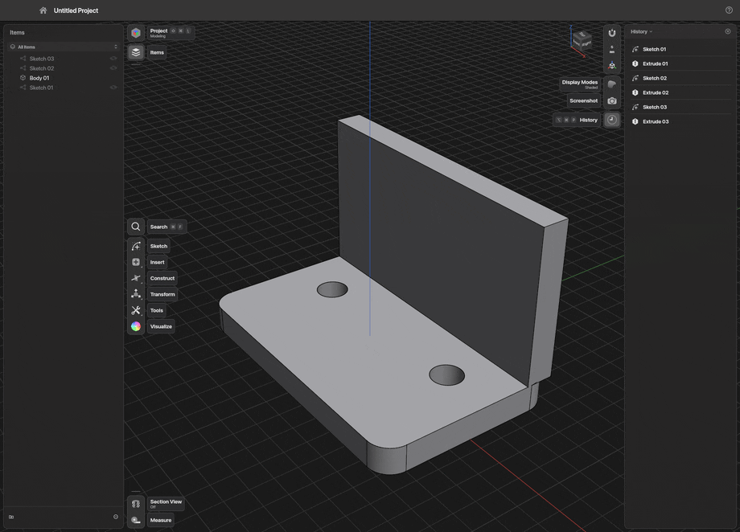

<p align="center">
  
</p>

<h1 align="center">ShapeCraft</h1>

<p align="center">
  <b>Push, pull, done.</b><br>
  Free 3D modeling for macOS, Windows and Linux. Sketch a shape, pull it into a solid, round the edges.<br>
  No account, no cloud, no subscription. Just you and the thing you're making.
</p>

<p align="center">
  <a href="https://github.com/jackharvest/shapecraft/releases/latest"><b>⬇️ Download</b></a> ·
  <a href="https://jackharvest.com/shapecraft">🌐 Website</a> ·
  <a href="https://github.com/jackharvest/shapecraft/issues/new/choose">🐛 Report an issue</a> ·
  <a href="https://www.buymeacoffee.com/jackharvest">☕ Prove my wife wrong</a>
</p>

<p align="center">
  <a href="https://github.com/jackharvest/shapecraft/actions/workflows/build.yml"></a>
  <a href="https://github.com/jackharvest/shapecraft/releases/latest"></a>
  
</p>

<p align="center"></p>
<p align="center"><sub>A whole handheld console, from a blank project to a lid that opens. Every step stays editable.</sub></p>

## Hi, welcome in 👋

ShapeCraft is for making real things: a part for your 3D printer, a box for your electronics, the bracket you've
been meaning to design for six months. You don't need to be an engineer, and you don't need to sign up for
anything. Download it, open it, and start shaping.

## The whole trick is three moves

<table>
  <tr>
    <td align="center" width="33%"><br><b>✏️ Sketch</b><br><sub>Draw on any face. Type a size whenever you know one.</sub></td>
    <td align="center" width="33%"><br><b>⬆️ Pull</b><br><sub>Grab it and drag. Up adds, down cuts.</sub></td>
    <td align="center" width="33%"><br><b>🔵 Round</b><br><sub>Drag an edge and it softens under your hand.</sub></td>
  </tr>
</table>

Then move it, copy it, pattern it, and send it to your printer.

## Why people like it

- 💸 **Free.** Not free-trial free. Free free, forever, and open source.
- 🔒 **Yours.** No account, no sign-in, no telemetry. Projects are plain folders on your disk, and it works on a plane.
- 🖱️ **Feels like home.** On first launch, pick the navigation your hands already know (a dozen popular CAD and 3D
  apps are in the list), so orbit, pan and zoom just work.
- ⏪ **Change your mind.** Every step stays in History. Change a number later and the model rebuilds.
- 📂 **Opens what you already have.** `.shapr`, STEP, Parasolid, IGES, STL, OBJ, 3MF, and DXF or SVG as sketches.
- 🎓 **Learn it over coffee.** Three built-in tutorials, about seven minutes each, in eleven languages.
- 🛟 **Hard to lose work.** Autosave, safe saves, and a project that reopens even after a crash.
- 🔄 **Keeps itself fresh.** New versions download in the background and install when you close the app.

## Get it in a minute

1. Grab the build for your computer from the [releases page](https://github.com/jackharvest/shapecraft/releases/latest)
   (Mac with Apple silicon or Intel, Windows x64, Linux x86_64).
2. Open it. The builds aren't signed with a paid certificate yet, so your computer asks once:
   - **macOS:** System Settings ▸ Privacy & Security ▸ **Open Anyway**.
   - **Windows:** in SmartScreen choose **More info**, then **Run anyway**.
   - **Linux:** allow the AppImage to run as a program (Properties, or `chmod +x`), then double-click it.
3. Make something. 🎉

It's an **alpha**, so keep backups of anything precious, and tell us when something feels off.

## Say hi

- 🐛 Something broke or felt wrong? [Open an issue](https://github.com/jackharvest/shapecraft/issues/new/choose) with
  the steps, and the project folder if you can. Every report makes the next version better.
- ☕ Want to help keep it going? [Buy a coffee](https://www.buymeacoffee.com/jackharvest). It pays for tools and
  hardware, and proves a point at home.
- ⭐ Like it? A star helps other makers find it.

<br>

---

<h2 align="center">🤓 The nerdy half</h2>
<p align="center"><sub>Everything below is for tinkerers, scripters, builders and people who read changelogs for fun.</sub></p>

## Everything that works

- **Sketching:** lines, arcs, splines, rectangles, circles, polygons and text, with snapping, inference,
  constraints, driving dimensions and linked patterns. Type a size at any time.
- **Modeling:** extrude, revolve, sweep, loft, fillet (radius or chordal, G1 or G2, setback corners, curvature),
  chamfer, shell, offset face, booleans, split, mirror, patterns, move and rotate with linked or unlinked copies,
  wrap and emboss.
- **History:** every step stays editable on its Parameter Card; change a number and the model rebuilds.
- **Files:** projects are folders (`project.json` plus STEP). Open and save STEP, IGES, Parasolid XT, STL, 3MF, OBJ
  and `.shapr`; export glTF, and 2D drawings to PDF, SVG, DXF and DWG.
- **Visualize:** materials you drag onto bodies, HDR panoramas, display modes, section views.
- **Navigation presets** for twelve apps' mouse conventions, plus trackpad gestures; orbit and pan can be flipped
  per axis.
- **Eleven interface languages**, light and dark themes, Vulkan, Metal, DirectX 12 and OpenGL, with a software
  fallback. If a GPU drops out mid-session, it saves and restarts on another.

Status and plans are in [docs/roadmap.md](docs/roadmap.md); what changed in each version is in
[CHANGELOG.md](CHANGELOG.md); how updates work is in [docs/updates.md](docs/updates.md).

## Drive it from scripts and agents

Every menu item, tool and key is a registered command. The same commands are reached by the CLI, a JSON control
channel and a built-in MCP server, so an agent can model while you watch.

```sh
shapecraft-cli commands                      # list every command and its parameters
shapecraft-cli mcp                           # MCP server on stdio, headless
shapecraft --control 47811                   # start the app with the control channel on
shapecraft-cli mcp --connect 47811           # …and drive the open app, so you can watch
shapecraft-cli run part.jsonl --save out/ --png part.png
```

The handheld at the top was built that way, one command at a time. Details, conventions and a one-line client
setup: [docs/mcp.md](docs/mcp.md).

## Build from source

Needs Rust (stable) and Open CASCADE 7.8 or newer, linked dynamically. Set `OCCT_INCLUDE_DIR` (the folder holding
`Standard.hxx`) and `OCCT_LIB_DIR` if it's somewhere the build doesn't look.

- macOS: `brew install opencascade`.
- Linux: your distribution's OCCT development package when it is 7.8+ (Fedora 41+, Arch, Debian 13+), or OCCT from
  conda-forge (`micromamba create -n occt -c conda-forge occt`, then point the two variables at
  `$CONDA_PREFIX/include/opencascade` and `$CONDA_PREFIX/lib`). The window also needs the usual X11/Wayland
  development libraries (xkbcommon, wayland, X11, Xcursor, Xrandr, Xi, GL).
- Nix (Linux): `nix develop`, or `direnv allow` with nix-direnv, sets all of the above up.
- Windows (MSVC): OCCT from conda-forge (`Library\include\opencascade`, `Library\lib`) or vcpkg; put the OCCT DLLs
  on `PATH` to run.

```sh
git clone https://github.com/jackharvest/shapecraft
cd shapecraft
cargo run --release -p shapecraft
```

On Linux, `sh packaging/linux/install.sh` installs a release build into `~/.local` with a launcher entry.
`packaging/proxmox/shapecraft-lxc.sh` makes a Proxmox VE container for headless modeling over MCP (`--help`).

## Architecture

```text
geom ─ kernel (traits) ─ kernel-occt (the only crate that touches Open CASCADE)
                │
               doc ─ engine (commands, undo, History) ─ render (wgpu)
                                    │
                         ui-egui · mcp ─ apps: shapecraft · shapecraft-cli · shapecraft-snap
```

The geometry kernel sits behind one set of Rust traits, so it can be replaced. Nothing below the UI knows about
egui. See [docs/architecture.md](docs/architecture.md).

## How it's made

ShapeCraft is built by one applications engineer with more than twelve years in the trade, working with AI coding
agents. The agents write much of the code. A person decides what gets built and how it should behave, and checks that
it's right: by hand on real parts, with automated tests, on all three operating systems, and side by side with the
tools it's measured against. It's clean-room: no code, files or artwork from other CAD products.

## Contributing

Bug reports are the most useful help: [open an issue](https://github.com/jackharvest/shapecraft/issues/new/choose)
with the steps and, if you can, the project folder. For code, read [CONTRIBUTING.md](CONTRIBUTING.md) and the
clean-room rules in [AGENTS.md](AGENTS.md) first.

## Disclaimer

The files in this repository are provided as is, without warranty, liability or indemnity. Check anything you'll
manufacture. Read [DISCLAIMER.md](DISCLAIMER.md).

## Licence

MIT OR Apache-2.0, at your option ([LICENSE-MIT](LICENSE-MIT), [LICENSE-APACHE](LICENSE-APACHE)). Open CASCADE
Technology is LGPL-2.1 with its exception and is linked dynamically; required notices are in [NOTICE](NOTICE). Every
file asset is listed in [ATTRIBUTION.md](ATTRIBUTION.md).

ShapeCraft is independent and clean-room: behaviour comes from using software as any user would, from public
documentation and from public format specifications. It is not affiliated with, sponsored by or endorsed by
Shapr3D Zrt. or any other CAD vendor. Shapr3D is a trademark of its owner, named only to describe file
compatibility.
